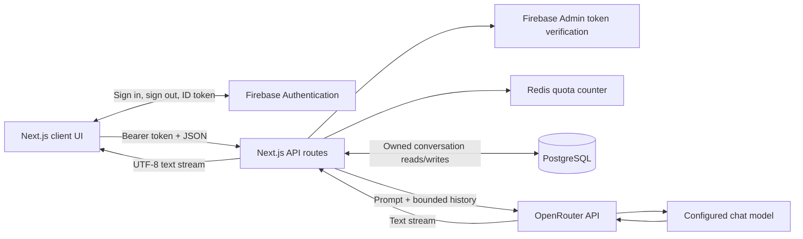

# Consumer Compass — Technical Project Report

**Snapshot date:** 2026-10-23
**Scope:** Current checked-out source, configuration, tests, and deployment documentation. This report describes repository contents; it does not imply that every optional integration or deployment workflow is live.

## Executive summary

Consumer Compass is a full-stack Next.js application for an Ontario consumer-rights chat assistant. The browser authenticates with Firebase. App Router API routes verify Firebase ID tokens with Firebase Admin, persist conversations in PostgreSQL, apply a per-user Redis request quota, and stream model output from OpenRouter. Conversation ownership is enforced in database queries. The UI supports saved conversations, streamed responses, retrying incomplete replies, and stopping generation.

The repository also contains Vitest unit and service-integration tests, a Docker standalone build, Compose configurations, manual EC2 deployment scripts, HTTPS/Nginx setup, and optional AWS backup and monitoring scripts. The deployment design targets a single x86-64 EC2 host and explicitly has downtime during app replacement; it is not a high-availability or load-tested architecture.

The main product limitation is knowledge quality: the assistant uses a static system prompt and model generation, without retrieval, authoritative legal citations, legal review, or automated fact verification. Redis rate limiting intentionally fails open during Redis outages. Real Firebase/OpenRouter use and several optional AWS operations require operator credentials and are not proven merely by source or local tests.

## 1. Technology and runtime

| Area                      | Implementation                                                       |
| ------------------------- | -------------------------------------------------------------------- |
| Application framework     | Next.js 14 App Router, React 18, JavaScript/JSX                      |
| UI                        | Material UI 5, Emotion, `react-markdown`                             |
| Browser identity          | Firebase Authentication 10, email/password                           |
| Server identity           | Firebase Admin 13, ID-token verification including revocation checks |
| Model provider            | OpenAI JavaScript SDK compatible client pointed at OpenRouter        |
| Request/config validation | Zod 4                                                                |
| Persistent data           | PostgreSQL via `pg` connection pool                                  |
| Rate-limit state          | Redis via `ioredis` and an atomic Lua script                         |
| Logging                   | Pino with request context through `AsyncLocalStorage`                |
| Testing                   | Vitest 4, Vite 6; PostgreSQL and Redis integration projects          |
| Runtime image             | Node.js 22 Debian slim, Next standalone output, non-root `node` user |

Dependency ranges and commands are maintained in [package.json](package.json); the lockfile is `package-lock.json`. The project has no TypeScript compiler configuration. The `@/*` import alias maps to the repository root through [jsconfig.json](jsconfig.json). `react-router-dom` is present as a dependency, but navigation is implemented with Next.js App Router and `next/navigation`.

## 2. Architecture and request flow



The browser obtains a Firebase ID token for protected API requests. The server verifies it and derives the user ID from the verified token; it does not trust a user ID supplied in request data. Authenticated routes upsert the user record and scope conversation operations by that ID. The chat handler loads history from PostgreSQL, appends the server-owned system prompt, calls OpenRouter, and streams text while persisting the final or incomplete assistant response.

The source is organized around the Next.js App Router in `app/`, shared UI in `app/components/`, browser helpers in `app/lib/`, server-only services in `app/lib/server/`, SQL migrations in `migrations/`, automated tests in `tests/`, and deployment assets in `deploy/`, `scripts/`, and `docs/`.

## 3. Web pages and API routes

| Path                             | Purpose                                                                              |
| -------------------------------- | ------------------------------------------------------------------------------------ |
| `/`                              | Product introduction and deployment notice when Firebase web configuration is absent |
| `/auth/login`                    | Email/password sign-in                                                               |
| `/auth/register`                 | Email/password registration                                                          |
| `/auth/logout`                   | Waits for Firebase sign-out, then redirects; offers retry on failure                 |
| `/chat`                          | Authenticated conversation workspace and sidebar                                     |
| `/profile`                       | Authenticated profile page with the signed-in email                                  |
| `GET /api/health`                | Unauthenticated dependency health for PostgreSQL and Redis                           |
| `POST /api/chat`                 | Authenticated, rate-limited chat turn and text stream                                |
| `GET /api/conversations`         | List the current user's conversations                                                |
| `POST /api/conversations`        | Create an empty conversation                                                         |
| `GET /api/conversations/[id]`    | Retrieve an owned conversation and transcript                                        |
| `PATCH /api/conversations/[id]`  | Rename an owned conversation                                                         |
| `DELETE /api/conversations/[id]` | Delete an owned conversation and its messages                                        |

Every API route declares the Node.js runtime and is dynamic. The API route modules wire the underlying handlers and wrap them in request logging. The core logic is separated into injectable handlers/stores so unit tests can exercise behavior without real cloud services.

## 4. Authentication and authorization

The browser Firebase configuration is read from six `NEXT_PUBLIC_FIREBASE_*` variables in [app/lib/firebase.js](app/lib/firebase.js). Firebase is initialized only when `apiKey`, `authDomain`, `projectId`, and `appId` are nonempty. `AuthProvider` subscribes to Firebase auth-state changes and exposes `currentUser`, `userLoggedIn`, `loading`, and `firebaseConfigured`. `AuthGuard` waits for restoration before redirecting protected pages to login, and redirects authenticated users away from guest-only auth pages.

The browser sends `Authorization: Bearer <Firebase ID token>` using `currentUser.getIdToken()`. [app/lib/server/firebase-admin.js](app/lib/server/firebase-admin.js) accepts either a service-account JSON environment variable or the individual project ID, client email, and private-key settings. It verifies tokens with `verifyIdToken(token, true)`, which includes revocation/disabled-user checks. Missing credentials produce a safe configuration error; invalid/expired/revoked credentials return 401; Firebase infrastructure failures map to 503.

Chat and conversation routes require this verified identity. Ownership is checked in SQL for every read, write, rename, and delete. A valid UUID belonging to another user is treated as not found (404), avoiding disclosure of another user's conversation. The health endpoint is intentionally unauthenticated and returns only boolean dependency status.

Firebase web settings are public and embedded at build time; changes require rebuilding the image. Firebase Admin credentials and OpenRouter keys are server-only runtime settings and must not be exposed with `NEXT_PUBLIC_` names. The deployment docs require client and admin settings to refer to the same Firebase project.

## 5. API contracts and validation

### Chat request

`POST /api/chat` requires `Content-Type: application/json` and a Firebase bearer token. The strict JSON object contains a valid UUID `conversationId` and exactly one of:

```json
{
  "conversationId": "123e4567-e89b-42d3-a456-426614174000",
  "message": "Can I cancel my purchase?"
}
```

or an incomplete assistant message ID to retry:

```json
{
  "conversationId": "123e4567-e89b-42d3-a456-426614174000",
  "retryMessageId": "42"
}
```

Unknown fields and malformed IDs are rejected. New messages are trimmed, nonempty, and bounded by `CHAT_MAX_MESSAGE_CHARS`. Retry IDs are positive decimal integers limited to PostgreSQL `bigint`. The request body is streamed into a bounded buffer and rejected above 1 MiB before JSON parsing. The retry request can target only the latest incomplete assistant message in an owned conversation.

Successful generation is a raw `text/plain; charset=utf-8` stream. Responses set `Cache-Control: no-cache, no-store, no-transform`, `X-Accel-Buffering: no`, and `X-Content-Type-Options: nosniff`. The stream transports generated text only; it does not expose provider event framing, token usage, or finish metadata.

### Conversation requests

All conversation routes require bearer authentication. List returns `{ "conversations": [...] }`; create returns a 201 response containing `{ "conversation": ... }`; retrieval returns the conversation and messages; rename accepts a strict `{ "title": "..." }` body, trimmed to a nonempty value of at most 100 characters; deletion returns 204. Conversation responses use `Cache-Control: no-store`.

### Error behavior

Pre-stream errors use a JSON envelope with a stable error code, safe message, and optional field-validation details. Known errors use their explicit HTTP status; unexpected errors return a generic 500 without internal details. Relevant statuses include 400 for malformed requests, 401 for invalid/missing tokens, 404 for missing/unowned conversations, 409 for busy conversations or invalid retry state, 413 for request bodies over 1 MiB, 429 for the application quota, 499 for cancellation before a stream response, 502 for other provider failures, and 503 for unavailable configuration/services.

Once a streaming response has started, its HTTP status cannot be changed. A mid-stream failure terminates the stream; it cannot be represented as a new JSON error response. Logs can therefore record a request with status 200 and a stream outcome of `error`, `aborted`, or `cancelled`.

## 6. Persistence and turn lifecycle

The initial schema is [migrations/001_conversations.sql](migrations/001_conversations.sql):

| Table           | Data and constraints                                                                                       |
| --------------- | ---------------------------------------------------------------------------------------------------------- |
| `users`         | Firebase UID primary key, nullable email, creation timestamp                                               |
| `conversations` | UUID primary key, user foreign key, 1–100 character title, created/updated timestamps                      |
| `messages`      | Generated `bigint` ID, conversation foreign key, `user`/`assistant` role, text, incomplete flag, timestamp |

Foreign keys cascade user deletion to conversations and conversation deletion to messages. User messages must have nonempty content and cannot be marked incomplete. Assistant placeholders can be empty and incomplete. Indexes support conversation lists ordered by user and update time, plus transcript ordering by conversation and creation time. PostgreSQL `bigint` message IDs are represented as strings in JSON to avoid JavaScript precision loss.

The migration runner [scripts/migrate.mjs](scripts/migrate.mjs) applies lexically sorted files matching the numbered SQL naming convention. It creates `schema_migrations`, takes a PostgreSQL advisory lock to serialize runners, applies each migration in a transaction, records successful versions, and skips already-applied files. There are no down migrations; applied SQL should not be edited.

For a new chat turn, the store acquires a PostgreSQL **session-level advisory lock** for the conversation, verifies ownership, then uses a short transaction to auto-title an empty conversation, insert the user row and incomplete assistant placeholder, and load bounded complete history. It commits before calling the model but keeps the database connection and advisory lock for the generation. No transaction remains open during the provider call. Concurrent generation or deletion for the same conversation returns 409; unrelated conversations can proceed independently. Rename can occur while a model response is running.

On normal completion, generated assistant text is saved and marked complete before the response stream closes. On cancellation, timeout, or provider failure, text already accumulated by the server is saved with `incomplete=true`. Retry replaces the latest incomplete assistant row rather than appending another user question. Finalization is guarded to happen once when abort/error signals race. A fixed 120-second handler deadline bounds the request/generation lifecycle; the OpenRouter SDK timeout is 60 seconds and automatic SDK retries are disabled.

A process crash before finalization can leave an incomplete placeholder and lose text not yet committed. Generation holds one pooled PostgreSQL connection while streaming, so pool size bounds simultaneous work. The session advisory-lock design requires session-preserving connections and is incompatible with transaction-pooling proxies such as PgBouncer transaction mode. Conversation lists and transcripts are not paginated.

## 7. Model integration and domain prompt

[app/lib/server/openrouter.js](app/lib/server/openrouter.js) creates the OpenAI SDK client with base URL `https://openrouter.ai/api/v1`. The default model is `meta-llama/llama-3.3-70b-instruct`, overridden by `OPENROUTER_MODEL`; the API key is `OPENROUTER_API_KEY`. The configured identifier and account access are not checked against the live provider at build time.

The server owns the system prompt in [app/lib/server/system-prompt.js](app/lib/server/system-prompt.js). It frames the assistant around Ontario consumer rights and includes topics/examples covering cooling-off periods, misrepresentation, delivery, vouchers, reward points, scams, and complaints. The prompt is ordinary application text, not a legal knowledge base. There is no retrieval augmented generation, legal corpus, vector index, browsing integration, citation verification, or fine-tuning process. The application therefore cannot guarantee that generated legal guidance or examples are current or correct; this report does not assess the legal accuracy of those examples.

History is read from PostgreSQL, excludes incomplete assistant rows, and is bounded by the most recent message count and total content characters. Whole messages are selected; truncation does not split a message. The server adds its own system prompt and applies `CHAT_MAX_OUTPUT_TOKENS` to the provider request. Character limits are not token counts.

## 8. Rate limiting, logging, and health

The chat endpoint checks a Redis fixed-window quota after token verification and configuration parsing, before request-body validation, database writes, or provider use. The default is 10 authenticated chat requests per 60 seconds per Firebase UID. An atomic Lua script increments the counter, establishes/repairs its TTL, and returns the remaining time. Keys are namespaced and include a SHA-256 hash of the UID, not the raw UID. The threshold request is allowed; subsequent requests receive 429 and `Retry-After`. Retries and authenticated malformed/unowned requests also count. Other API routes do not use this limiter.

Redis has 500 ms connection/command timeouts, no offline queue, and no command retry loop. Redis failure intentionally **fails open**: the chat request proceeds and a generic warning is logged at most once per minute per process. Thus Redis is an abuse/spending guard, not a hard provider billing limit. Redis runs without persistence in the supplied Compose stacks, so restart resets counters.

All exported API handlers use Pino request logging. Each response gets an `X-Request-ID`; structured request completion fields include request ID, method, route template, status, latency, outcome, and verified UID when available. `AsyncLocalStorage` isolates user identity between concurrent requests. Logs redact/remove sensitive common fields and application events use static names; request bodies, prompts, messages, provider errors, and credentials are not intentionally logged. Streaming request latency measures through EOF/cancellation rather than only time to first byte.

`GET /api/health` checks `SELECT 1` against PostgreSQL and `PING` against Redis concurrently. It returns 200 with `{status:"ok", checks:{database:true,redis:true}}` only when both pass; otherwise it returns 503 and boolean check results. It does not check Firebase or OpenRouter. The Docker health check uses this endpoint. An unhealthy-but-running process is not automatically restarted just by Docker's `restart` policy.

## 9. Frontend behavior and safety

The root layout remains a server component, exports title/description metadata, and mounts a client `Providers` component containing one `AuthProvider`. MUI provides navigation, forms, dialogs, alerts, and layout. The chat workspace is keyed by Firebase UID so state is not reused when users change.

The chat page loads the latest updated conversation on entry. It provides create/open/rename/delete, auto-creates a conversation on the first send when needed, and refreshes transcript/list data after generation. Busy guards prevent overlapping operations. Enter submits, Shift+Enter inserts a newline, and IME composition is respected. Stop aborts the generation fetch while allowing transcript reconciliation. Error notices can offer retry and honor `Retry-After`; ambiguous failures reload saved state and restore the draft for review rather than blindly resending. The list scrolls to recent content.

Assistant output renders with `react-markdown`; raw HTML is skipped, remote images are disallowed, and default URL sanitization is retained. Links open in a new tab with `noopener noreferrer`. User content is rendered as text. There is no HTML injection plugin or `dangerouslySetInnerHTML` path in the Markdown renderer.

## 10. Configuration reference

Configuration templates are [`.env.example`](.env.example), [deploy/runtime.env.example](deploy/runtime.env.example), and [deploy/production.env.example](deploy/production.env.example). Values below describe the current code defaults and templates.

| Setting                                    | Purpose and default                                                                  |
| ------------------------------------------ | ------------------------------------------------------------------------------------ |
| `NEXT_PUBLIC_FIREBASE_API_KEY`             | Firebase browser app configuration                                                   |
| `NEXT_PUBLIC_FIREBASE_AUTH_DOMAIN`         | Firebase browser app configuration                                                   |
| `NEXT_PUBLIC_FIREBASE_PROJECT_ID`          | Firebase browser app configuration                                                   |
| `NEXT_PUBLIC_FIREBASE_STORAGE_BUCKET`      | Firebase browser app configuration; app does not currently use Firebase Storage      |
| `NEXT_PUBLIC_FIREBASE_MESSAGING_SENDER_ID` | Firebase browser app configuration                                                   |
| `NEXT_PUBLIC_FIREBASE_APP_ID`              | Firebase browser app configuration                                                   |
| `FIREBASE_SERVICE_ACCOUNT_JSON`            | Optional server credential JSON; takes precedence over individual fields             |
| `FIREBASE_ADMIN_PROJECT_ID`                | Firebase Admin project ID when JSON is not supplied                                  |
| `FIREBASE_ADMIN_CLIENT_EMAIL`              | Firebase Admin service-account email                                                 |
| `FIREBASE_ADMIN_PRIVATE_KEY`               | Firebase Admin private key; literal `\\n` is converted to newlines                   |
| `OPENROUTER_API_KEY`                       | Server-side provider credential; required for generation                             |
| `OPENROUTER_MODEL`                         | Model ID; defaults to `meta-llama/llama-3.3-70b-instruct`                            |
| `DATABASE_URL`                             | PostgreSQL connection string; required for persistence                               |
| `REDIS_URL`                                | Redis connection string; missing/unavailable Redis triggers fail-open quota behavior |
| `CHAT_MAX_MESSAGE_CHARS`                   | Default 8,000; valid range 1–32,000                                                  |
| `CHAT_HISTORY_MAX_MESSAGES`                | Default 20; valid range 1–500                                                        |
| `CHAT_HISTORY_MAX_CHARS`                   | Default 24,000; valid range 1–1,000,000 and must be at least message max chars       |
| `CHAT_MAX_OUTPUT_TOKENS`                   | Default 1,024; valid range 1–8,192                                                   |
| `CHAT_RATE_LIMIT_MAX_REQUESTS`             | Default 10; valid range 1–10,000                                                     |
| `CHAT_RATE_LIMIT_WINDOW_SECONDS`           | Default 60; valid range 1–86,400                                                     |
| `LOG_LEVEL`                                | Pino level: trace/debug/info/warn/error/fatal/silent; default info                   |

Invalid numeric chat configuration returns a safe 503. `DATABASE_URL` is required lazily when the database is first used; `OPENROUTER_API_KEY` is checked when a completion is requested. The app can serve public pages without Firebase browser configuration, but authentication and protected workflows will not be usable.

## 11. Build, deployment, and operations

### Local development

The main commands are `npm ci`, `npm run dev`, `npm run lint`, `npm run build`, and `npm start`. Local integration settings and setup are covered in [docs/phase-1.md](docs/phase-1.md), [docs/phase-2.md](docs/phase-2.md), [docs/phase-3.md](docs/phase-3.md), and [docs/phase-4.md](docs/phase-4.md). The migration command is `npm run db:migrate`; it reads `.env.local` through Node's `--env-file` option. A production start requires a successful build.

### Container deployment

[Dockerfile](Dockerfile) uses a Node 22 build stage, `npm ci`, one Next build worker, and Next standalone output. The runtime image is Node 22 Debian slim, runs as the non-root `node` user, includes static assets and migration dependencies, and defines a health check against `/api/health`. Public Firebase web variables are Docker build arguments; secrets are supplied only at runtime. The image carries an OCI source revision label.

`docker-compose.demo.yml` is a limited HTTP demo stack with app, PostgreSQL 16, Redis 7, and Nginx. It intentionally omits Firebase/OpenRouter credentials. `docker-compose.prod.yml` adds Nginx on ports 80/443, persists PostgreSQL in a named external volume, keeps Redis ephemeral, binds the app to localhost:3000, sets small-host memory limits, and expects a runtime env file. `docker-compose.test.yml` provides disposable PostgreSQL/Redis test services. `docker-compose.cloudwatch.yml` is an optional logging-driver override requiring AWS setup.

The production path and operational cautions are described in [docs/deploy-ec2.md](docs/deploy-ec2.md); the temporary demo instructions and recorded smoke-check evidence are in [docs/deploy-demo.md](docs/deploy-demo.md). Production configuration separates Compose interpolation (`.env.production`) from raw Docker runtime settings (`runtime.env`). PostgreSQL data should be backed up before risky migrations; Redis state is disposable.

Nginx templates support HTTP bootstrap and HTTPS/Certbot. The production Nginx config disables buffering, caching, and gzip for `/api/chat`, with a 150-second read timeout. The base Nginx config sets `client_max_body_size 128k`, lower than the app's 1 MiB JSON parser cap. Current per-message defaults fit within that proxy ceiling, but the two limits are not equivalent; a future larger request may be rejected by Nginx before reaching the app.

### CI and deploy automation

[.github/workflows/ci.yml](.github/workflows/ci.yml) runs checks on pull requests only. Its check job provisions PostgreSQL 16 and Redis 7 services, runs `npm ci`, lint, migration, all Vitest projects, production build, and deployment-shell syntax validation. Direct pushes to `main` trigger no workflow, so they neither consume GitHub Actions runner time nor deploy to EC2. The workflow no longer contains an automated deployment job.

Manual deployment tooling remains in the repository. [scripts/deploy-ec2.sh](scripts/deploy-ec2.sh) validates a revision/checksum, loads the image, applies migrations before replacing the running app, waits for the new app, validates/reloads Nginx, checks health, and records the deployed/previous image. On failure after replacement it attempts to restore the previous image. [scripts/compose-prod.sh](scripts/compose-prod.sh) selects the deployed image and optionally adds CloudWatch logging config. This is a single-host replacement and can incur downtime; rollback restores application code but does not reverse database migrations. These scripts require an operator to run them and are not invoked by pushes to `main`.

### Optional operations

- [scripts/backup-db.sh](scripts/backup-db.sh) creates a compressed logical PostgreSQL dump and uploads it to an operator-specified S3 bucket using SSE-S3, then removes its temporary file.
- [scripts/enable-https.sh](scripts/enable-https.sh) obtains a Let's Encrypt HTTP-01 certificate and swaps the active Nginx template, restoring the previous template if verification fails.
- [scripts/renew-cert.sh](scripts/renew-cert.sh) renews certificates and validates/reloads Nginx; systemd service/timer units are under `deploy/`.
- [scripts/health-metric.sh](scripts/health-metric.sh) probes the local HTTPS endpoint and publishes a CloudWatch health metric.
- CloudWatch log/metric/alarm setup and EC2 IAM permissions are documented, but AWS resources are not created by merely checking out the repository.

## 12. Tests and verification

Vitest projects are configured in [vitest.config.mjs](vitest.config.mjs):

| Command              | Coverage / dependencies                                                                                        |
| -------------------- | -------------------------------------------------------------------------------------------------------------- |
| `npm test`           | Unit, mocked route, client, Markdown, logging, health, and deployment control-flow tests; no external services |
| `npm run test:db`    | PostgreSQL persistence and exported API integration tests; requires migrated disposable test DB                |
| `npm run test:redis` | Redis limiter integration tests; requires disposable Redis and explicit test URL                               |
| `npm run test:all`   | All Vitest projects; requires configured test services                                                         |

Coverage areas include schema/config validation, Firebase Admin token verification with mocks, auth-before-provider behavior, streaming and cancellation, history truncation, SQL ownership and ordering, turn/abort/retry persistence, advisory-lock concurrency, cascade deletion, Redis atomicity/isolation/expiry/TTL repair, Markdown XSS-sensitive behavior, request logging/redaction, health checks, and deployment rollback control flow. The API integration tests exercise exported Next route functions with real PostgreSQL/Redis while mocking Firebase and OpenRouter. They are not full browser or external-service end-to-end tests.

The PR workflow is configured to run lint, migrations, all tests, build, and shell syntax checks. For this report update, `npm test` passed (87 tests across 10 files) and `npm run lint` passed with no warnings or errors. The PostgreSQL/Redis integration projects were not run in this pass. These results do not establish that external Firebase/OpenRouter or AWS integrations are available. `docs/deploy-demo.md` records a manual EC2 demo smoke check on 2026-10-23: public pages/assets and `/api/health` returned 200, health showed PostgreSQL/Redis true, and unauthenticated chat/conversation API calls returned 401. That record is a point-in-time smoke check, not load testing, browser automation, or validation of live model/auth flows.

## 13. Known limitations and operational risks

- **Legal reliability:** The model response is not retrieved from or checked against current law or official sources. No citations or legal review are enforced.
- **Quota availability tradeoff:** Redis outage fails open, temporarily removing the application's request quota. Provider-side account limits remain separate.
- **Single-host deployment:** The documented EC2 topology has a single app/database host and downtime during replacement. It has no database HA or zero-downtime rollout.
- **Session locks:** Conversation generation uses session-level PostgreSQL advisory locks and holds one pooled connection during the provider stream. Transaction-pooling middleware is incompatible.
- **Crash consistency:** Assistant content is committed at completion/interruption, not token by token. A hard process crash may lose generated text and leave an incomplete placeholder.
- **Data lifecycle:** Conversation/message retention and account deletion UX are not implemented. Conversation and transcript APIs are not paginated.
- **Health scope:** Health checks PostgreSQL and Redis, not Firebase, OpenRouter, TLS validity from an independent location, or user-facing correctness.
- **Request-size layers:** Nginx's 128 KiB request limit is stricter than the app's 1 MiB body parser limit.
- **Deployment rollback:** App rollback does not undo schema changes; migrations must be planned to remain compatible with the previous release.
- **External verification:** Real Firebase/OpenRouter calls, a full production EC2 deployment, HTTPS renewal, S3 restore, CloudWatch delivery/alarms, and production load behavior require separate live verification.

## Overall assessment

Compared with the initial prototype described in the previous report, the current checkout implements server-side identity verification, strict chat contracts, durable conversation ownership and transcripts, atomic Redis quotas, stream lifecycle management, structured logs, health checks, and a test/deployment path. It is a substantially more complete application and operational baseline. It should still be regarded as a small single-host service rather than a high-availability or legally authoritative product, and optional cloud workflows should be considered configured only after they have been exercised in the target accounts and environment.
