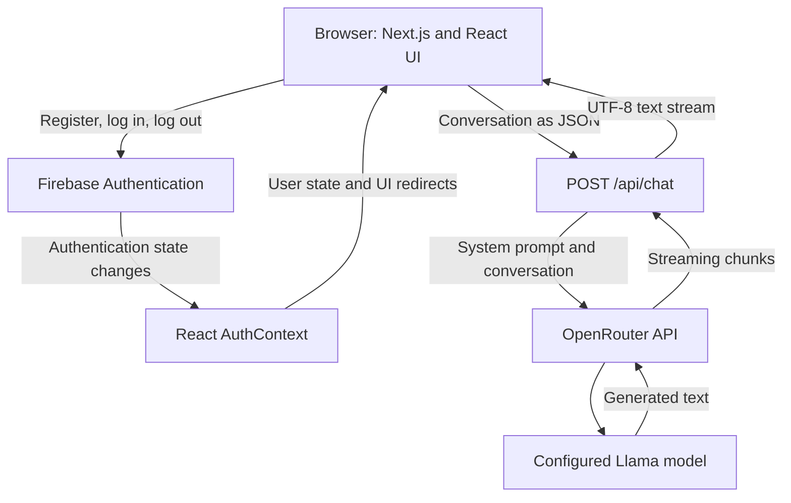

# Consumer Compass — Technical Project Report

Consumer Compass is a small full-stack web application that provides an AI chat interface for questions about Ontario consumer rights. It combines Firebase authentication, a Material UI frontend, and a Next.js API endpoint that streams model responses through OpenRouter.

The code implements the main prototype workflow—register, log in, and chat—but has gaps around authorization, error handling, and conversation management.

This report is based on a review of all application source files and project configuration. Dependencies were not installed, the application was not run, and external services were not verified. Findings describe the checked-in implementation rather than verified runtime behavior.

## 1. Technology stack

The exact versions recorded in `package-lock.json` are:

| Technology | Version | Role |
|---|---|---|
| Next.js | 14.2.5 | File-based routing, application shell, server API |
| React / React DOM | 18.3.1 | Components, state, context, effects |
| Material UI | 5.16.6 | Forms, navigation, menus, layout, chat bubbles |
| Emotion React | 11.13.0 | Styling infrastructure for Material UI |
| Firebase | 10.12.5 | Browser-side authentication |
| OpenAI JavaScript SDK | 4.54.0 | Client for OpenRouter's compatible API |
| ESLint | 8.x dependency range | Static linting with Next.js rules |

The project uses JavaScript and JSX, with no TypeScript configuration or application types. `react-router-dom` 6.26.0 is installed, but the application uses Next.js navigation instead.

The application and API live in the same Next.js project. There is no separate backend service in this repository. Dependencies and commands are defined in [package.json](package.json).

## 2. Architecture and data flow



There are two largely independent flows:

- **Authentication:** the browser communicates directly with Firebase.
- **Chat generation:** the browser sends messages to the Next.js server, which calls OpenRouter.

The key architectural gap is that these flows are not connected on the server. The chat endpoint does not verify the user's Firebase identity.

## 3. Repository structure and routes

The app uses the Next.js App Router, with routes defined under `app/`.

| Route | Source | Implementation |
|---|---|---|
| `/` | [app/page.js](app/page.js) | Welcome page explaining Consumer Compass |
| `/auth/register` | [app/auth/register/page.js](app/auth/register/page.js) | Email/password account creation |
| `/auth/login` | [app/auth/login/page.js](app/auth/login/page.js) | Email/password sign-in |
| `/auth/logout` | [app/auth/logout/page.js](app/auth/logout/page.js) | Sign-out followed by login redirect |
| `/chat` | [app/chat/page.js](app/chat/page.js) | Conversation interface with streamed responses |
| `/profile` | [app/profile/page.js](app/profile/page.js) | Displays the authenticated user's email |
| `/api/chat` | [app/api/chat/route.js](app/api/chat/route.js) | Server endpoint that requests model output |

Shared components provide the navigation bar, side drawer, account menu, and authentication form:

- [Navbar.jsx](app/components/Navbar.jsx)
- [TemporaryDrawer.jsx](app/components/TemporaryDrawer.jsx)
- [AccountMenu.jsx](app/components/AccountMenu.jsx)
- [AuthForm.jsx](app/components/AuthForm.jsx)

The profile page is minimal: it does not offer profile editing, account deletion, or password management.

## 4. Authentication implementation

Authentication is split across three files:

- [firebase.js](app/lib/firebase.js) initializes Firebase and exports its authentication instance.
- [auth.js](app/lib/auth.js) wraps Firebase operations.
- [AuthContext](app/context/authContext/index.jsx) shares authentication state with components.

The context exposes:

```js
{
  currentUser,
  userLoggedIn,
  loading
}
```

On mount, `AuthProvider` subscribes to Firebase's `onAuthStateChanged`. When Firebase reports a user, it updates `currentUser` and `userLoggedIn`; otherwise, it clears them. It unsubscribes when the provider unmounts.

The intended login sequence is:

1. `AuthForm` collects email and password.
2. The login page calls `signInWithEmailAndPassword`.
3. Firebase updates the authentication state.
4. The context updates.
5. The login page redirects to `/chat`.

Registration follows the same pattern using `createUserWithEmailAndPassword`.

### Authentication issues

- **Authentication readiness is ignored.** The context starts with `userLoggedIn: false` and `loading: true`, but protected pages redirect without checking `loading`. A returning user can be sent to login before Firebase finishes restoring their session.
- **Registration failure handling is broken.** The catch handler in `app/auth/register/page.js` calls `setIsSigningIn(false)`, which is undefined in that component. It should reset `isRegistering`. A failed registration therefore also triggers a JavaScript error.
- **Some helpers are incomplete.** Google sign-in, password reset, and password update reference `signInWithPopup`, `sendPasswordResetEmail`, and `updatePassword`, respectively, without importing them. Google sign-in is also commented out in the UI.
- **The homepage nests another `AuthProvider` inside the root provider.** This creates an unnecessary second authentication subscription and independent context state.
- **Redirects are implemented inconsistently.** Registration and profile redirects occur during rendering; the login and chat pages use effects.
- **Logout does not await sign-out.** The logout page calls `doSignOut()` and immediately redirects, without explicit error handling.

## 5. Chat state and request lifecycle

The [chat page](app/chat/page.js) maintains two pieces of local state:

```js
messages // Array of { role, content }
message  // Current input field value
```

It starts with a predefined assistant greeting welcoming the user to the Ontario Consumer Rights Assistant.

When Send is clicked, the page:

1. Builds a user message from the input.
2. Clears the input.
3. Adds the user message and an empty assistant message to the UI.
4. Posts the existing conversation plus the new user message to `/api/chat`.
5. Reads the response stream.
6. Appends each decoded text chunk to the last message.

The empty assistant message acts as the placeholder that fills as the model responds. Functional state updates preserve previously received chunks during rendering.

### Conversation storage and context

Conversation history exists only in React memory. There is no database integration, conversation identifier, local-storage persistence, or saved transcript. Reloading or remounting the chat page resets it.

The full conversation is resent on every request. This gives the model multi-turn context, but increases request size and model input as the conversation grows. There is no truncation or summarization mechanism.

Firebase is used for authentication only in the application source. The presence of Firebase project configuration does not imply that the app stores chats in Firestore or another Firebase database.

### Chat UI limitations

- Empty messages can be submitted.
- Send remains enabled during generation.
- There is no cancellation or retry control.
- Errors are logged to the console without a user-facing message.
- The fetch handler does not check `response.ok`.
- Responses render as ordinary text, without Markdown handling.
- There is no explicit automatic scrolling.
- There is no native form submission or Enter-key handler for sending messages.

The most significant chat-state bug concerns overlapping requests. Every stream appends to the last message in the array. If a second request starts before the first finishes, both streams can update the same final message and mix their responses.

## 6. AI backend and streaming

The only custom server endpoint is [app/api/chat/route.js](app/api/chat/route.js).

It initializes the OpenAI SDK with:

```js
baseURL: "https://openrouter.ai/api/v1"
apiKey: process.env.OPENROUTER_API_KEY
```

The SDK is being used as a client for OpenRouter. The configured model identifier is:

```text
meta-llama/llama-3.1-8b-instruct:free
```

This is the identifier in the repository; its present availability has not been checked.

The endpoint expects the request body to be a message array, prepends its own system message, and requests streaming generation:

```js
messages: [
  { role: "system", content: systemPrompt },
  ...data
],
stream: true
```

### Domain specialization

The system prompt defines an Ontario consumer-rights assistant and includes the following topics:

- Cooling-off periods.
- Misrepresentation.
- Delivery of goods.
- Group deal vouchers.
- Reward points.
- Scams and fraud protection.
- Consumer complaints and reporting scams.

It also embeds example questions and answers to guide the model's behavior.

This is prompt-based specialization. The repository contains no retrieval pipeline, legal document index, vector database, browsing integration, or fine-tuning workflow. Responses depend on the configured model and the instructions and examples embedded in the prompt. The implementation does not verify legal statements or attach authoritative citations. This report does not assess the legal accuracy of the embedded examples.

### Streaming implementation

The server:

1. Iterates over upstream completion chunks.
2. Extracts `choices[0]?.delta?.content`.
3. Encodes the text using `TextEncoder`.
4. Enqueues the bytes into a Web `ReadableStream`.
5. Returns that stream through `NextResponse`.

The browser uses `TextDecoder` to reconstruct the text. The app forwards a raw text stream, without retaining upstream event framing or metadata such as token usage and completion reasons. It does not explicitly set streaming response headers.

## 7. Server-side gaps

The most consequential issue is missing API authorization.

The browser redirects signed-out users away from `/chat`, but `/api/chat` has no Firebase token verification. Anyone able to reach the endpoint can call it directly without going through the login screen. The browser request does not attach a Firebase ID token, and the server does not establish a verified user identity.

| Gap | Practical effect |
|---|---|
| No request schema validation | Malformed bodies and invalid message structures are not handled deliberately |
| No message-role restrictions | Callers control the roles and content forwarded after the server prompt |
| No application rate limiting | The app has no per-user request or usage controls |
| No history or output limits | There is no explicit application-level context or generation budget |
| No outer error handler | JSON parsing and initial provider failures lack a controlled error response |
| No cancellation propagation | Client disconnects are not explicitly connected to upstream cancellation |

There is also a stream lifecycle issue: the catch block calls `controller.error(err)`, and the `finally` block then calls `controller.close()`. Closing an already errored stream can raise another error.

These are production-readiness concerns visible in the source. Their runtime behavior has not been tested as part of this review.

## 8. Frontend structure and styling

Material UI supplies nearly all visual structure through `Box`, `Stack`, `Typography`, `TextField`, `AppBar`, `Drawer`, and menu components. Styling is mostly inline through `sx`, with a small global CSS reset in [public/globals.css](public/globals.css).

The [root layout](app/layout.js) is marked `"use client"` and wraps the app in `AuthProvider`. This makes the shared layout part of the client component tree; the API route remains server-side. A separate client-side provider component would allow the root layout to remain a server component.

Other implementation details:

- Inter is configured through `next/font/google`.
- Metadata configuration is commented out.
- Navigation changes according to authentication state.
- Assistant messages align left and user messages align right, with different bubble colors.
- The authentication form uses fixed dimensions, which may constrain mobile layouts.
- The authentication container's width contains a `100wh` typo.
- The authentication form is not an HTML `<form>`, so it lacks native form-submit behavior.
- Login errors are rendered both inside the form and again by the login page.
- Authentication buttons display progress text, but do not use the `disabled` attribute to communicate or enforce the pending state at the button level. The login and registration handlers do have state-based guards.

## 9. Configuration and deployment

The repository provides these commands:

```bash
npm ci
npm run dev
npm run lint
npm run build
npm start
```

`npm ci` installs the locked dependencies. The scripts start the development server, run linting, build the application, and start the production server, respectively. A production start requires a successful build first.

The AI integration requires a server environment variable:

```env
OPENROUTER_API_KEY=...
```

Firebase client configuration is hardcoded in `app/lib/firebase.js`. There is a commented environment-variable alternative, but it is inactive. No environment example file is included.

The project uses the `@/*` import alias, mapped to the repository root in [jsconfig.json](jsconfig.json).

Deployment configuration is sparse:

- [next.config.mjs](next.config.mjs) contains an empty configuration object.
- [README.md](README.md) is the default Next.js starter documentation.
- [awsSync.txt](awsSync.txt) contains a manual `rsync` command targeting an AWS EC2 host, suggesting an intended EC2 deployment. It does not establish that a deployment is currently running.
- No Dockerfile, CI workflow, process-manager configuration, or reverse-proxy setup is included.
- There are no repository tests or test scripts.

## 10. Overall assessment

The strongest parts of the project are its small, understandable structure and complete browser-to-model streaming path. It demonstrates Firebase email/password authentication, shared React authentication state, App Router navigation, server-side model integration, and incremental rendering of generated text.

The main unfinished areas are server-side identity verification, reliable authentication initialization, request validation, stream error handling, and persistent conversation storage. The broken registration error handler and overlapping-stream behavior are concrete implementation defects that can disrupt ordinary usage.

The code is best understood as a focused prototype of an authenticated consumer-rights chat application. Its UI login requirement currently does not provide server-side access control for model requests, and its answers are generated from a fixed prompt without a verified legal knowledge source.
